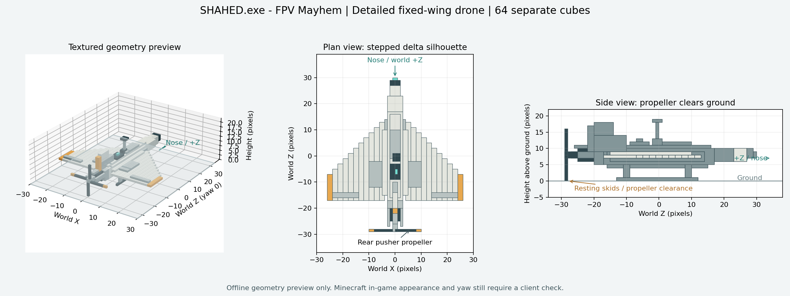

# Модели и исходники ресурсов

Дрон — оригинальная условная модель с дельтавидным крылом в стиле Minecraft. Текущая детализация: **64 отдельных кубоида**, включая гранёный фюзеляж и нос, физический объектив FPV-камеры, ступенчатые панели крыла, элероны, киль, крепления мотора, четыре лопасти заднего винта, люки, антенну и посадочные опоры. Анимаций нет.

Габариты в покое: длина **59 пикселей = 3,6875 блока**, размах **52 пикселя = 3,25 блока**, высота **19 пикселей = 1,1875 блока**. Это геометрические размеры; Minecraft использует отдельный консервативный прямоугольный хитбокс сущности. Одна единица модели равна одному пикселю, 16 единиц — одному блоку.

## Дрон: редактирование и ориентация

`drone-model.json` — редактируемый чертёж геометрии, материалов и UV. Во время игры используется Java-класс `DroneModel`, а не JSON-загрузчик. При изменениях синхронизируйте Java-модель и этот файл.

`drone.bbmodel` — **Blockbench Free Model**, формат `4.10`: 64 редактируемых кубоида, группа `drone`, UV всех граней и встроенная PNG-текстура **256 × 256**. Открывается через **File → Open Model** без плагина. Автоматического переноса изменений из Blockbench в Java нет.

Нос направлен по локальной **−Z**, задний винт — по **+Z**, верх — по **−Y**. Java-корень `[0, 16, 0]` и преобразования рендерера размещают землю на локальном `Y = 8`. В Blockbench используется **+Y вверх**: `blockbenchY = 8 − javaLocalY`; pivot корня — `[0, 8, 0]`.

Java-рендерер поворачивает модель на `180 − entityYaw` вокруг Y с учётом переворота осей модели. При yaw `0` нос смотрит по мировому **+Z**, при yaw `90` — по **−X**. Носовая камера закреплена на расстоянии **1,875 блока вперёд** и **0,55 блока вверх** от начала координат сущности; крепление вращается с реальным тангажом и креном дрона. Сглаживание направления взгляда не перемещает объектив относительно корпуса. Собственная модель дрона скрывается во время FPV.



Предпросмотр построен вне игры по чертежу и атласу. Он проверяет геометрию и непрозрачность всех **384 граней**; игровые освещение, рендеринг, ориентацию и камеру нужно проверять в клиенте.

Атлас использует стандартную развёртку `ModelPart.Cube`. Для UV `[u, v]` и размера `[x, y, z]` занята область шириной `2(x + z)` и высотой `y + z`. Парные элементы одного размера и материала используют общие UV. Верх после переворота Y соответствует минимальному локальному Y: прямоугольник `[u + z + x, v]`. Светлые панели, тёмные механические части, оранжевые законцовки и бирюзовый объектив создаются программно; на борту остаётся оригинальный пиксельный знак `KRA` вымышленного производителя ТОВ «КРИВІ РУКИ AEROSPACE».

## Пульт и очки: настоящие объёмные предметы

Канонические исходники — `src/main/resources/assets/shahed/models/item/controller.json` и `fpv_goggles.json`. Это стандартные ванильные JSON-модели из **19** и **17** кубоидов соответственно. В моделях есть геометрия корпуса, экрана, джойстиков, рукояток и антенны пульта; корпуса визора, двух линз, носовой выемки, боковых креплений, ремня и антенны очков. Используются штатные текстуры бетонных блоков и шерсти Minecraft; дополнительные библиотеки или внешние ресурспаки не нужны.

`display` задаёт отдельные преобразования для инвентаря, рук от первого/третьего лица, рамки и земли. У очков есть `display.head`; визор расположен перед глазами, а ремень идёт по бокам и сзади головы. Положение рассчитано по `CustomHeadLayer` Minecraft 26.2: сдвиг `−0,25` по Y, поворот Y `180°`, масштаб `[0,625, −0,625, −0,625]`. При нулевом `display.head` центр визора около Y `−0,25` относительно головы, передняя часть находится перед лицевой плоскостью Z `−0,25`. Встроенные преобразования уже учтены в координатах кубоидов; дополнительные смещения вверх/назад не нужны.

## Регенерация

Оригинальные текстуры, старые совместимые иконки предметов и иконка мода воспроизводятся Python 3 с Pillow:

```sh
python3 docs/model/generate_assets.py
```

Скрипт читает геометрию и материалы дрона из `drone-model.json`. Объёмные JSON-модели пульта и очков сохраняются; скрипт не заменяет их плоскими предметами. Они редактируются непосредственно в JSON или импортируются как Java Block/Item в Blockbench. Изображения предметов 32 × 32 оставлены в ресурсах для совместимости и как исходные иконки, но пульт и очки рендерятся объёмными моделями.

Экспорт Blockbench из чертежа не требует дополнительных Python-пакетов:

```sh
python3 docs/model/export_model.py
```

Для текстурированного PNG-предпросмотра дополнительно нужны Pillow, NumPy и Matplotlib:

```sh
MPLCONFIGDIR=/tmp/shahed-matplotlib python3 docs/model/export_model.py --preview
```

Эти зависимости нужны только для редактирования ресурсов и не требуются для Gradle или игры. Экспорт не меняет Java-код или игровые ресурсы.
